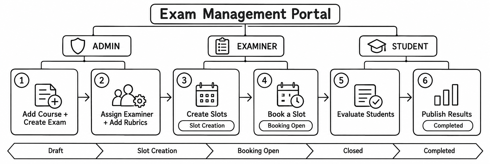

<div align="center">

# Examination Management Portal (EMP)

### A simple, role-based portal for managing viva, practical, and project-demo examinations.


**Admin · Examiner · Student — one portal, three roles**

</div>

---

## Overview

The Examination Management Portal (EMP) brings the main steps of an examination into one place. The admin prepares courses and exams, examiners set up time slots and evaluate students, and students book a suitable slot and check their results once they are published.

The project is designed to run locally on a computer using Flask and SQLite. It keeps the workflow straightforward and gives each role access to the pages and actions it needs.

> **Local setup:** The app runs locally. The pages load Bootstrap from a CDN, so an internet connection is needed to fetch the stylesheet unless you configure Bootstrap locally.

## Workflow

The exam moves through a defined sequence of statuses, from initial setup to published results.



1. **Create the exam** — the admin adds a course, creates the exam, sets its dates, assigns an examiner, and adds marking rubrics.
2. **Create slots** — once the exam enters **Slot Creation**, assigned examiners can create available slots within the configured date window.
3. **Open booking** — when the status changes to **Booking Open**, students can book an available slot during the booking period.
4. **Evaluate students** — examiners record marks against the exam rubrics and can add remarks.
5. **Publish results** — the admin publishes the results, after which students can view their marks and download their scorecard.

The status sequence is:

`Draft` → `Slot Creation` → `Booking Open` → `Closed` → `Completed`

## Roles and features

### Admin

- View a dashboard with exam, booking, examiner-workload, and progress summaries.
- Add, edit, search, and manage courses.
- Create and update examinations, manage their status, assign or remove examiners, and publish results.
- Set marking rubrics for each exam. The total rubric marks cannot exceed the exam's maximum marks.
- Add students and examiners, approve pending examiner registrations, and activate or deactivate accounts.
- View all slots and change a slot's assigned examiner.
- Review bookings and move a student to another open slot for the same exam.

### Examiner

- View assigned exams, upcoming slots, and evaluations that still need attention.
- Create, edit, and remove slots with a date, time, capacity, and venue.
- View students booked into their slots.
- Evaluate or re-evaluate eligible students using rubric marks and remarks.

### Student

- View open exams, available slots, upcoming exams, and recent results.
- Search exams by name, course, or type, then book an available slot.
- Review booking history and cancel an active booking.
- View published marks and remarks, and download a scorecard as a text file.
- Update profile details and change the account password.

Tables include search where appropriate and show the total number of records. Longer tables scroll within their cards while keeping the heading row visible.

## Getting started

### Requirements

- Python **3.9 or newer**
- Flask **3.x** and the packages listed in `requirements.txt`
- A modern web browser

### Option 1: Run on Windows

1. Extract the project folder, `24F2008737`.
2. Double-click `run.bat`.
3. Let the script install the requirements and start the application.
4. Open [http://127.0.0.1:5000](http://127.0.0.1:5000) in your browser.

### Option 2: Run manually

From the project directory, install the dependencies and start the app:

```bash
pip install -r requirements.txt
python app.py
```

Then visit [http://127.0.0.1:5000](http://127.0.0.1:5000).

You can also start it with Flask's CLI:

```bash
flask --app app run
```

The database tables are initialized when `app.py` is imported.

### Reset the local database

To start with a fresh database, stop the application and delete `Database/emp.db`. Start the app again and the database and initial admin account will be created.

**Note:** Resetting the database removes the existing application data. Back up `Database/emp.db` first if you need to keep it.

## Accounts and access

### Admin

The admin account is created during the initial database setup. Its username and password are configured in `config.py` using `ADMIN_USERNAME` and `ADMIN_PASSWORD`.

For safety, change the default credentials before sharing or deploying the project, and do not publish real passwords in a public repository.

### Student

On the login page, choose **Create a student or examiner account**, complete the registration form, and sign in.

### Examiner

Examiner registrations remain pending until an admin approves the account under **Admin → Examiners**. The admin can also create student and examiner accounts directly.

## Project structure

```text
24F2008737/
├── app.py                         # App entry point and database initialization
├── config.py                      # Configuration, admin credentials, statuses
├── helpers.py                     # Shared login and booking helpers
├── api_routes.py                  # JSON API endpoints
├── run.bat                        # Windows startup script
├── requirements.txt               # Python dependencies
├── README.md
│
├── Login and Registration/
│   ├── login.html                 # Login page
│   ├── Registration.html          # Student and examiner registration
│   └── auth_routes.py             # Login, registration, and logout
│
├── Admin/
│   ├── Admin_dashboard.html       # Admin interface
│   └── admin_routes.py            # Courses, exams, rubrics, users, bookings
│
├── Examiner/
│   ├── Examiner_dashboard.html    # Examiner interface
│   └── examiner_routes.py         # Slot management and evaluation
│
├── Student/
│   ├── Student_dashboard.html     # Student interface
│   └── student_routes.py          # Booking, profile, and scorecard
│
├── EMP_WorkFlow.png               # Examination workflow diagram used above
│
├── Database/
│   ├── database.py                # Schema and database helper functions
│   └── emp.db                     # Created automatically on first start
│
└── Style/
    └── Style.css                  # Stylesheet used across the pages
```

Each HTML page contains its own document structure, header, and sidebar. The role folders keep the relevant page and Python route file together; the project does not use a shared base-layout template.

## Built-in rules and safeguards

- A student can have only one active booking per exam. They must cancel it before choosing another slot.
- Booking is handled one seat at a time to prevent two students from taking the final seat simultaneously.
- Examiners cannot create overlapping slots on the same day or create slots in the past.
- A slot can be edited or removed only while it has no bookings and the exam is in **Draft** or **Slot Creation**.
- Examiners can evaluate only students who booked one of their own slots.
- Marks must stay within the maximum allowed for each rubric criterion. Published marks are locked.
- Courses that already have exams, and exams that already have slots, cannot be deleted. Set them inactive or closed instead.
- Routes are protected by role, so users are redirected to the appropriate area when they try to access pages outside their permissions.
- Passwords are stored as hashes rather than plain text.

### Slot and booking statuses

- **Slot:** `Available` → `Full` → `Completed`
- **Booking:** `Booked` → `Completed` after evaluation, or `Cancelled`

A slot is marked **Completed** only when no student is waiting for evaluation and no seats remain free.

## Database

The application uses SQLite, with the database stored at `Database/emp.db`. The schema is created by `init_db()` in `Database/database.py`; no manual table setup is needed.

| Table | Purpose |
|---|---|
| `users` | Admin, examiner, and student accounts, including role and status |
| `courses` | Course code, name, description, and status |
| `exams` | Exam details, maximum marks, dates, and status |
| `assignments` | Examiner-to-exam assignments |
| `rubrics` | Marking criteria for each exam |
| `slots` | Slot date, time, capacity, available seats, and venue |
| `bookings` | Student bookings for exam slots |
| `evaluations` | Total marks, remarks, and publication state |
| `evaluation_marks` | Marks awarded for individual rubric criteria |

## JSON API

The following endpoints require a logged-in user:

| Endpoint | What it returns |
|---|---|
| `GET /api/exams` | Exams; admins can also see drafts |
| `GET /api/slots` | Slots, optionally filtered with `?exam_id=1` |
| `GET /api/bookings` | Bookings visible to the current role: all for admins, own slots for examiners, and own bookings for students |

Requests without a login receive an HTTP `401` response.

## Notes for development

- Route names use role-based Flask blueprints, for example `auth.login`, `admin.show_page`, `examiner.save_slot`, and `student.book_slot`. Follow the same naming pattern when adding routes.
- The role folders are added to the Python import path in `app.py`. Keep that setup in place when reorganizing the project.
- To add an admin page, update `ADMIN_PAGES` in `admin_routes.py`, provide the page data in `show_page`, and add the matching conditional block and sidebar link in `Admin_dashboard.html`.
- Replace `SECRET_KEY` in `config.py` before using the app beyond local development.
- `debug=True` in `app.py` is intended for local development only. Disable debug mode before deploying anywhere accessible to other users.

## Project details

| Field | Details |
|---|---|
| Project | Examination Management Portal (EMP) |
| Creator | Zaira Rahman |
| Email | zairarahman24@gmail.com |
| Project folder / ID | `24F2008737` |
| Stack | Python, Flask, Jinja2, SQLite, Bootstrap |

---

<div align="center">

**Examination Management Portal · 24F2008737**

</div>
